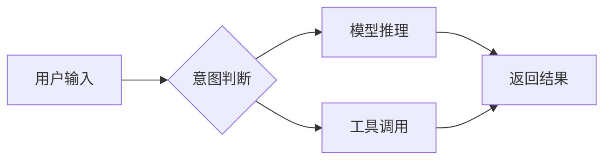

这篇是给站长自己用的语法速查手册，展示本博客支持的全部交互内容。每一段都放了渲染效果，方便对照。

## Mermaid 流程图

````markdown

````


## 提醒块（四种颜色）

```markdown
:::tip 小贴士
这是一条提示。
:::
```

:::tip 小贴士
这是一条提示，绿色。
:::

:::warning 注意
这是一条警告，黄色。
:::

:::info 信息
这是一条信息，蓝色。
:::

:::danger 危险
这是一条危险提示，红色。
:::

## 折叠块（点击展开）

```markdown
+++点击展开
这里是被折叠的内容。
+++
```

+++点击展开
这里是被折叠的内容，可以放代码、图、任何东西。
+++

## 标签卡（切换页签）

;;;id1 默认
第一个标签页的内容。
;;;id1 源码
标签卡的源码用 `;;;分组名 标签名` 开始，`;;;` 结束。
;;;

## 数学公式

行内：质能方程 $E = mc^2$

块级：

```markdown
$$
\int_{-\infty}^{\infty} e^{-x^2} dx = \sqrt{\pi}
$$
```

$$
\int_{-\infty}^{\infty} e^{-x^2} dx = \sqrt{\pi}
$$

## 文字特效

++这是下划线++、==这是高亮==、~~这是删除线~~

!!这是剧透内容，点击显示!!

{文字^注音} 的写法可以标注读音

## Quiz 练习题（点击选项判定）

```markdown
- 下列哪个是 JavaScript 的基本数据类型？{.quiz}
  - Object{.options}
  - Array{.options}
  - Symbol{.correct}
  - Function{.options}

> 解析：Symbol 是 ES6 引入的基本数据类型。
```

- 下列哪个是 JavaScript 的基本数据类型？{.quiz}
  - Object{.options}
  - Array{.options}
  - Symbol{.correct}
  - Function{.options}

> 解析：Symbol 是 ES6 引入的基本数据类型，而 Object、Array、Function 都是引用类型。

## 链接卡片

单独一行贴一个网址（或引用式链接），会自动生成 OG 预览卡片：

[Astro 官方文档](https://docs.astro.build/)

## 使用备忘

- `quiz: true` 和 `math: true` 写在 frontmatter 才启用测验和公式
- 代码块里嵌套代码块时，外层用四个反引号 ``````
- 这些语法都来自 Shoka 主题兼容层，详见仓库 AGENTS.md 与原主题文档
