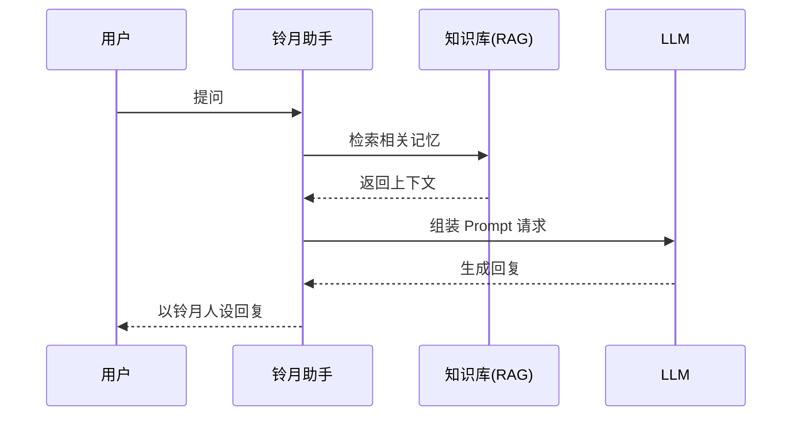
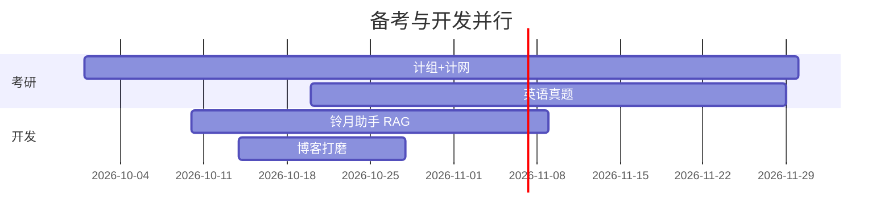
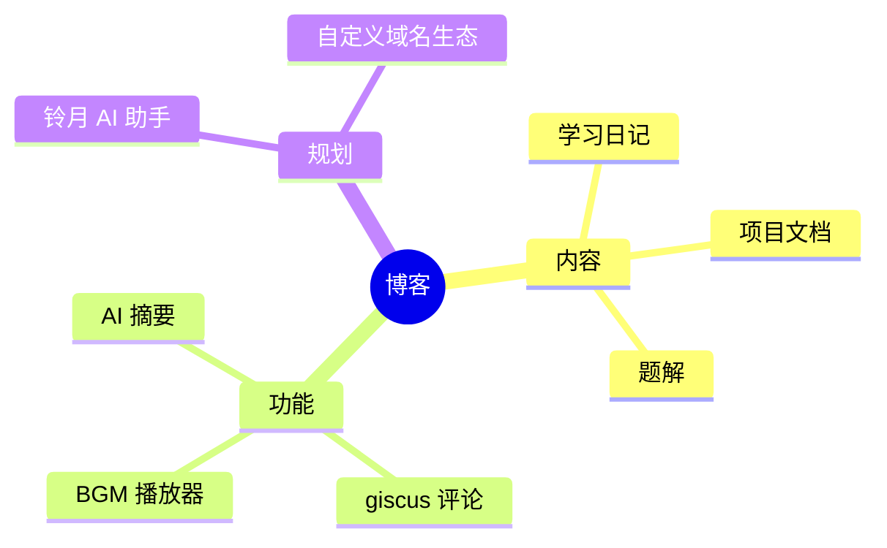
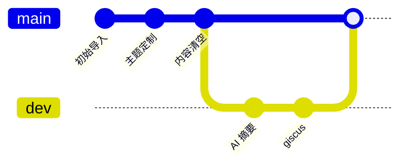

进阶版语法手册。基础版（提醒块/折叠块/下划线高亮）见上篇，这里只放重型武器。

## 一、Infographic 信息图（AntV，20+ 模板）

代码块语言标记 `infographic`，第一行选模板，YAML 式数据。**渲染出来是可交互的矢量信息图。**

### 技术栈卡片（list-grid-badge-card）

```infographic
infographic list-grid-badge-card
data
  title 铃月 AI 助手技术栈
  desc 规划中的核心组件
  items
    - label RAG 检索
      desc 记忆与知识库召回
      icon mdi/database-search
    - label 角色人设
      desc 铃月人格与语气控制
      icon mdi/account-voice
    - label 记忆模型
      desc 长短期记忆分层管理
      icon mdi/head-cog
    - label 插件系统
      desc 博客与工具链接入
      icon mdi/puzzle
```

### 之字形步骤（sequence-zigzag-steps-underline-text）

```infographic
infographic sequence-zigzag-steps-underline-text
data
  title 模型训练全流程
  items
    - label 数据收集
      desc 自建语料与角色对话集
    - label 清洗标注
      desc 数据清洗 + 标签注入
    - label SFT 训练
      desc 基底模型 + LoRA 微调
    - label 量化部署
      desc 本地推理与效果验证
```

### 二元对比（compare-binary-horizontal-simple-fold）

```infographic
infographic compare-binary-horizontal-simple-fold
data
  title 补偿 vs 协作
  items
    - label 补偿
      desc 弥补模型能力短板，下一代模型就会同化掉
    - label 协作
      desc 把人的意图、上下文、规则接到 Agent 行动上，模型学不到
```

### 环形图（chart-pie-donut-pill-badge）

```infographic
infographic chart-pie-donut-pill-badge
data
  title 时间分配
  items
    - label 考研复习
      value 45
    - label 项目开发
      value 30
    - label 刷题
      value 15
    - label 写博客
      value 10
```

### SWOT 分析（compare-swot）

```infographic
infographic compare-swot
data
  title 自习室占座项目 SWOT
  items
    - label 优势
      desc KNN+决策树双算法落地，真机可跑
    - label 劣势
      desc WiFi 指纹采集依赖人工标注
    - label 机会
      desc 校园场景高频刚需
    - label 威胁
      desc 同类产品成熟度高
```

> 其余模板族：`sequence-circular-simple`（圆形流程）、`sequence-roadmap-vertical-simple`（路线图）、`sequence-pyramid-simple`（金字塔）、`hierarchy-tree-tech-style-capsule-item`（科技树）、`chart-column-simple`（柱状）、`chart-line-plain-text`（折线）、`quadrant-quarter-simple-card`（象限）、`relation-circle-circular-progress`（关系图）。换第一行模板名即可。

## 二、Mermaid 全家桶

### 时序图



### 甘特图



### 思维导图



### Git 提交图



## 三、代码块元数据（标题/行高亮/命令标记）

````markdown
```js title="hello.js" url="https://example.com" linkText="查看源码" mark:1,3
const greeting = 'Hello';
const name = 'World';
console.log(`${greeting}, ${name}!`);
```
````

```js title="hello.js" url="https://example.com" linkText="查看源码" mark:1,3
const greeting = 'Hello';
const name = 'World';
console.log(`${greeting}, ${name}!`);
```

命令行标记（自动加 `$` 前缀、区分命令与输出）：

````markdown
```bash command:("$":1-3)
npm install astro
npm run dev
npm run build
```
````

```bash command:("$":1-3)
npm install astro
npm run dev
npm run build
```

## 四、Quiz 四种题型

多选（`.quiz .multi`）：

- 以下哪些是 CSS 布局方式？{.quiz .multi}
  - Flexbox{.correct}
  - jQuery{.options}
  - Grid{.correct}
  - Float{.correct}

> 解析：Flexbox、Grid、Float 都是布局方式；jQuery 是 JS 库。

判断（`.quiz .true` 答案为真，默认为假）：

- `const` 声明的变量不能重新赋值，但可以修改其属性。{.quiz .true}

> 解析：`const` 只保证绑定不可变，对象属性仍可修改。

填空（`[答案]{.gap}`）：

- 在 JavaScript 中，`typeof null` 的结果是 [object]{.gap}。{.quiz .fill}

> 解析：历史遗留 bug。常见错误答案 [null]{.mistake}。

## 五、加密内容块（AES-256-GCM 真加密）

```markdown
:::encrypted{password="demo123"}
这里的内容在**构建时**就加密了，密码不会出现在最终 HTML 里。
:::
```

:::encrypted{password="demo123"}
这段内容构建时用 AES-256-GCM 加密，输密码 demo123 才能看。适合放私人资源链接、付费片段。
:::

## 六、媒体与链接

B 站/音频嵌入：

```markdown

- title: 铃月的歌单
  list:
    - https://music.163.com/playlist?id=18484255305

```

友链卡片墙：

```markdown

- site: 策锁
  url: https://mjzy.tech
  owner: Dusty
  desc: ai时代的探索与agent深度使用者
  image: 头像链接
  color: '#3df072'

```

## 七、行内属性（万能逃生舱）

`[文字]{.class}` 可以给任意行内文字挂 class，配合自定义 CSS 就是万能样式：

```markdown
[红色文字]{.text-red-500} [加粗小字]{.font-bold.text-sm}
```

示例：[红色文字]{.text-red-500}

## 备忘

- frontmatter 开关：`quiz: true` / `math: true`（本篇已开）
- infographic 的 icon 用 mdi/iconify 图标集
- Mermaid 渲染后的图支持缩放拖拽（zoom-pan）
- 所有 Shoka 功能可在 site.yaml `content:` 段独立开关
