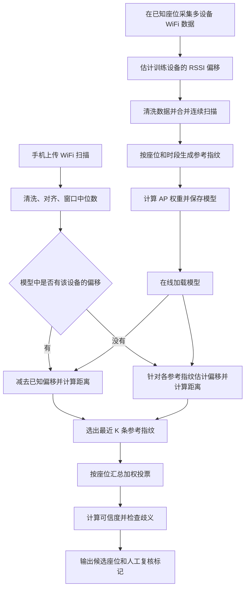

这个项目实现的是 **“多参考指纹的加权 KNN + 设备 RSSI 偏移适配 + 可信度判断”**。

它解决的问题是：**手机扫描到一组 WiFi 信号后，判断这组信号最像哪个座位上采集的信号。**

## 算法里的数据是什么

**WiFi 指纹**是一组 AP 的信号强度。这里 AP 可以简单理解为无线接入点，RSSI 是手机测到的接收信号强度，通常为负数：
- `-40 dBm` 比较强。
- `-70 dBm` 比较弱。
- 数值越接近 0，信号越强。

假设房间里选用了 4 个 AP，同一时刻扫描得到：

|位置|AP1|AP2|AP3|AP4|
|---|---|---|---|---|
|座位 A|-45|-60|-75|-65|
|座位 B|-65|-45|-60|-75|
|当前手机|-46|-59|-74|-66|

当前手机的信号组合显然更接近座位 A。

这就是指纹定位的基础：不同位置与各 AP 的距离、遮挡和反射条件不同，形成不同的信号组合。算法比较的是这种组合，输出座位编号。

需要注意，**这里计算的“距离”是两个 RSSI 向量的差异，不是手机到座位的米数。**

---

## 先看整体流程，可以分为离线建库和在线匹配两部分



## **第一步，把扫描数据整理成可以比较的向量**

原始扫描中，每个 AP 至少有两个重要字段：
```plain
bssid：标识 AP 的无线接口
rssi：当前信号强度
```

这里使用 BSSID，而不是 WiFi 名称 SSID。因为多个 AP 可以都叫同一个 WiFi 名称，直接用名称会把不同信号源混在一起。

预处理依次做这些事情：
1. 统一 BSSID 格式，过滤不合法的 BSSID。
2. 过滤不在默认 `[-95, -25] dBm` 范围内的 RSSI。
3. 同一次扫描里，重复 BSSID 的读数取中位数。
4. 按模型保存的 BSSID 顺序排列。
5. 没扫到的 AP 填 `-100`。
6. 多次扫描之间，按 AP 分别取中位数。

例如，模型规定顺序是：
```plain
[AP1, AP2, AP3, AP4]
```

手机只扫到：
```plain
AP3 = -73
AP1 = -46
AP4 = -65
```

对齐后的向量就是：
```plain
[-46, -100, -73, -65]
```

`-100` 在这里主要承担“缺失标记”的作用。

如果同一个 AP 连续 5 次扫描得到：
```plain
[-60, -59, -80, -61, -60]
```

取中位数后是：
```plain
-60
```

这样一次突发的 `-80` 不会明显拉偏结果。某个 AP 在部分扫描中缺失时，中位数只使用实际有效值；整个窗口都没扫到才保留 `-100`。

你需要区分两个同为 5 的参数：

|参数|当前默认值|含义|
|---|---|---|
|`window`|5|离线每组最多合并 5 次扫描，形成一个查询或训练向量|
|`k`|5|匹配时选择最近的 5 条参考指纹参与投票|

它们控制的是两个不同阶段。

当前离线窗口按“座位、设备、批次”分组，再按时间排序，每 5 条切一组，末尾不足 5 条也会使用。在线接口则处理这次请求中实际上传的扫描列表，**不会自动等到凑够 5 次才匹配**。

---

## **第二步，离线建立“座位参考指纹库”**

KNN 的主要工作是保存参考样本，预测时与参考样本比较。因此这个项目所谓的“训练”，主要包括：
- 估计训练设备的偏移。
- 整理扫描窗口。
- 构建每个座位的参考向量。
- 计算 AP 权重。
- 拟合可信度模型。

当前参考指纹按：
```plain
座位编号 + 采集时段
```

分组，时段划分为：
```plain
morning：06:00～11:59
afternoon：12:00～17:59
evening：其余时间
```

同一组中的窗口向量，在每个 AP 维度上取有效值的平均数。

因此一个座位可能保存：
```plain
A-01 上午参考指纹
A-01 下午参考指纹
A-01 晚间参考指纹
```

注意这里有两层聚合：
```plain
一个窗口内的多次扫描 → 中位数
同座位、同时段的多个窗口 → 平均数
```

当前保存的实现的包含：

|内容|数量|
|---|---|
|座位|48 个|
|AP 维度|12 个|
|参考指纹|144 条|
|K|5|

也就是这个模型每个座位有 3 条时段参考指纹。

**预测时会同时比较所有时段的参考指纹，不会根据当前时间只查某一个时段。** 时段在这里用于保留环境变化下的不同信号形态。

这也解释了为什么之前“每个座位只有一条指纹”会削弱 KNN 的作用：每个座位最多获得一个邻居的票，按反距离评分时，Top-1 基本就是最近的那条参考。现在同一个座位可以获得多条参考的共同支持。

---

## **第三步，训练设备之间先做 RSSI 偏移校正**

不同手机在同一位置测到的 RSSI 可能整体不同，例如：

|设备|AP1|AP2|AP3|
|---|---|---|---|
|手机 A|-50|-60|-70|
|手机 B|-56|-66|-76|

A 比 B 整体高了约 6 dB。

如果直接混合建库，设备差异就会被掺入位置特征。因此当前代码先寻找：

```plain
相同座位 + 相同日期 + 相同时段 + 共同 AP
```

下的不同设备数据。

先对各组取中位数，再计算两台设备之间的差值中位数，得到关系：

$[ o_A-o_B\approx 6 ]$

其中 \(o_A,o_B\) 是设备偏移。

多台设备会形成一组这样的方程，代码使用最小二乘求解，并添加约束：

$[ \sum_d o_d=0 ]$

这个约束的作用是确定共同基准。只有相对差值时，整体加上任意常数都满足设备间的差值关系，需要固定一个基准才能得到唯一结果。

上面两台设备的结果就是：

```plain
A 的偏移：+3
B 的偏移：-3
```

归一化采用：

$[ RSSI_{\text{normalized}}=RSSI_{\text{raw}}-o_d ]$

于是：

```plain
A：[-50,-60,-70] - 3  = [-53,-63,-73]
B：[-56,-66,-76] -(-3)= [-53,-63,-73]
```

两台设备被对齐到共同基准。

这里的偏移是**相对于训练设备共同基准的偏移**，并不是相对于某个绝对标准仪器的误差。

另外，设备之间不要求每两台都有直接交叉采样，但交叉关系必须连通。例如 A 与 B 有共同采样，B 与 C 有共同采样，也能建立 A、B、C 的相对关系。完全孤立的设备会让训练报错，要求补采。

---

## **第四步，计算每个 AP 的重要程度**

直观上：

- 如果某个 AP 在所有座位上都是 `-60` 左右，它不太能区分座位。
- 如果另一个 AP 在不同座位上从 `-40` 变化到 `-80`，它可能更有区分能力。

代码计算每个 AP 在参考指纹中的标准差 $(\sigma_i)$，忽略缺失值，然后转换成权重：

$[ w_i=0.2+0.8\frac{\sigma_i}{\max_j\sigma_j} ]$

所以 AP 权重落在：

$[ [0.2,1.0] ]$

这里准确地说使用的是**标准差**；文件顶部部分说明写成了方差，以实际函数为准。

这个做法简单实用，但有一个局限：它统计的是全部参考条目，座位差异和时段波动都会贡献标准差。因此“变化大”未必完全等于“定位可靠”。后续有真实数据后，可以再区分座位间差异与同一座位内部噪声。

---

## **第五步，计算当前指纹与每条参考指纹的距离**

这一步分为已登记设备和新设备两种情况。

对于模型里已有偏移的设备，先减去设备偏移，再计算加权均方根距离：

$[ d(q,r)= \sqrt{ \frac{\sum_i w_i'(q_i-r_i)^2} {\sum_i w_i'} } ]$

其中：

- $(q_i)$：当前手机校正后的第 \(i\) 个 AP 信号。
- $(r_i)$：参考指纹对应信号。
- $(w_i')$：本次比较使用的 AP 权重。

如果当前查询没有扫到某个 AP，该维度的权重会乘以 `0.1`：

$[ w_i'= \begin{cases} 0.1w_i,&q_i=-100\\ w_i,&其他 \end{cases} ]$

这样漏扫一个 AP 不会产生过大的影响，但也不会完全忽略缺失。

举一个权重相同的例子：

```plain
当前指纹 q = [-50,-60,-70]
参考指纹 r = [-52,-61,-68]
```

则：

$[ d= \sqrt{\frac{2^2+1^2+(-2)^2}{3}} =\sqrt3 \approx1.732 ]$

距离越小，两组信号越接近。

---

### **新设备的距离计算，是这次设备适配改动的核心**

新设备没有已知偏移。当前代码的做法是：

> 分别假设当前手机位于每条参考指纹对应的位置，估计这个假设下需要怎样的整体 RSSI 偏移，再检查剩余差异是否合理。

例如某条参考是：

```plain
r = [-55,-65,-75,-60]
```

新设备上传：

```plain
q = [-50,-60,-70,-55]
```

逐项相减：

```plain
q-r = [5,5,5,5]
```

这很像设备整体偏强 5 dB。

针对每条参考，代码执行以下计算。

先找共同 AP 集合 \(C_r\)：查询和参考都不是缺失值的 AP。**共同 AP 不足 3 个时，这条参考不参与有效的偏移拟合。**

然后估计偏移：

$[ b_r= \operatorname{clip} \left( \operatorname{weightedMedian}_{i\in C_r}(q_i-r_i), -12,12 \right) ]$

这里用 AP 权重计算加权中位数，降低个别异常 AP 的影响，并把结果限制在 `±12 dB`。

接着计算扣除偏移后的残差：

$[ e_r= \sqrt{ \frac{\sum_{i\in C_r}w_i(q_i-r_i-b_r)^2} {\sum_{i\in C_r}w_i} } ]$

如果各 AP 都近似相差 5，那么 \(b_r\approx5\)，\(e_r\approx0\)。

但如果差值是：

```plain
[5,-8,13,-2]
```

就难以用一个整体偏移解释，残差通常会更大。

最后构造用于 KNN 排序的距离：

$\$[ d_r= \sqrt{e_r^2+0.02b_r^2} + 2\left(1-\frac{|C_r|}{|Q|}\right) ]$

其中 \(Q\) 是查询向量中有效 AP 的集合。

这个公式有三部分作用：

|项目|作用|
|---|---|
|残差 \(e_r\)|衡量偏移校正后，信号形状是否相似|
|偏移惩罚 \(0.02b_r^2\)|避免通过过大的整体平移强行贴合参考|
|覆盖惩罚|惩罚共同 AP 占查询有效 AP 的比例过低|

即便“偏移 5 dB 后完全重合”，最终距离也不是零：

$\$[ d=\sqrt{0.02\times5^2}\approx0.707 ]$

这是代码主动保留的偏移代价。

**每条参考都有自己的临时偏移估计。** 最终响应中的 `device_offset`，取获胜座位中距离最近的那条参考所估计的偏移，当前不会把它永久登记为设备标定值。

---

## **第六步，取最近的 K 条参考指纹，按座位投票**

假设取出的 5 条最近参考是：

|参考指纹|距离|
|---|---|
|A-01 上午|1.0|
|A-02 下午|1.2|
|A-01 下午|1.4|
|A-01 晚间|1.8|
|A-03 上午|2.0|

每条参考的投票权重为：

$[ v_j=\frac1{d_j+10^{-6}} ]$

距离越近，票越重。小常数用于避免除零。

按座位汇总：

$[ S(c)=\sum_{\substack{j\in TopK\\seat(j)=c}}v_j ]$

于是大约得到：

```plain
A-01：1/1.0 + 1/1.4 + 1/1.8 = 2.270
A-02：1/1.2                 = 0.833
A-03：1/2.0                 = 0.500
```

A-01 获胜。

所以代码中有两种不同的“权重”：

- **AP 权重**：决定计算距离时，更重视哪些信号维度。
- **邻居权重**：决定投票时，更重视哪些参考样本。

最终按座位总分从高到低排序；分数相同时，优先选择最近参考距离更小的座位。

`K=5` 是取 5 条参考，不是 5 个座位。`top_n=3` 则表示最多返回 3 个不同座位。假如 K 条参考只涉及两个座位，返回结果也只有两个，不会强行补足。

---

## **第七步，判断这次结果有多可信**

仅仅获得第一名还不够，因为每次比较总会有一个相对最好的候选，即使整体匹配质量很差。

代码使用三个特征计算可信度：

|特征|含义|
|---|---|
|`top1_distance`|获胜座位最近一条参考的距离 \(d_1\)|
|`separation`|最近其他座位参考的距离与 \(d_1\) 的差|
|`vote_share`|获胜座位得分占全部 K 条邻居总分的比例|

特别注意 `separation`：

$[ separation=d_2-d_1 ]$

其中 \(d_2\) 来自**所有其他座位参考中的最近距离**，并不一定是投票第二名座位的距离，也不限于 Top-K 内的参考。

这样即使 Top-K 的投票集中在一个座位上，代码仍会检查外面是否存在很接近的其他座位。

`vote_share` 为：

$[ vote\_share=\frac{S(c_{\text{winner}})}{\sum_cS(c)} ]$

它只是投票得分占比，**不是预测正确概率**。

当前保存的模型用逻辑回归估计可信度：

$[ z=\beta_0+\beta_1d_1+\beta_2separation+\beta_3vote\_share \]\[ confidence=\frac1{1+e^{-z}} ]$

结果再限制在 `[0.01,0.99]`。

逻辑回归训练时，把历史预测是否正确作为标签：

```plain
预测座位 = 真实座位 → 1
预测座位 ≠ 真实座位 → 0
```

用这些样本学习三个特征与预测正确性的关系。

需要准确理解：这个输出是**根据已有数据拟合出的正确概率估计**，不是已经得到保证的真实场地正确率。尤其当前模型来自模拟数据，不能把一次输出 `0.99` 直接理解成实地一定有 99% 把握。

如果训练数据不足以拟合逻辑回归，例如没有同时包含预测正确和错误的样本，就退回启发式公式：

$[ confidence= \sqrt{ \max(0,1-d_1/5) \cdot \operatorname{clip}(separation/2,0,1) } ]$

同样再限制输出范围。

---

## **第八步，还有一些条件会直接要求人工复核**

即使上面的可信度估计较高，代码仍会检查证据是否充分。

以下情况会把可信度置为 `0`：

- 查询有效 AP 或获胜参考的共同 AP 少于 3 个。
- 新设备估计偏移达到 `±12 dB` 上限。
- 新设备偏移校正后的残差大于 `5 dB`。
- 存在其他座位，其偏移校正残差不大于获胜参考残差加 `0.3 dB`，说明存在歧义。

最后一条非常关键。

假设：

```plain
座位 A 的参考：[-50,-60,-70]
座位 B 的参考：[-55,-65,-75]
当前手机信号：[-50,-60,-70]
```

可能有两种解释：

```plain
手机在 A，设备偏移为 0
手机在 B，设备偏移为 +5
```

两者偏移校正后的残差都为 0。仅凭这一组 RSSI，无法可靠区分位置差异和设备差异。

所以当前实现会保留候选，但要求人工确认。

这说明**新设备临时偏移适配能够缓解跨设备问题，却不能保证任何设备第一次进入都能自动准确定位**。若要进一步消除这种歧义，需要已知位置的标定样本，或者引入更多观测信息。

此外，可信度低于默认阈值 `0.60` 也会要求复核，但这种情况下不一定把可信度清零。

---

**用实际代码跑一个例子，会更直观。**

我取当前保存模型中的：

```plain
A-01 下午参考指纹
```

人为把有效 RSSI 整体增加 `5 dB`，四舍五入成整数，然后作为一台未登记设备的扫描输入。正常执行了 RSSI 过滤。

这是用于解释算法的合成输入，不是独立精度测试。

得到最近 5 条参考：

|参考|距离|邻居权重|
|---|---|---|
|A-01 下午|0.7872|1.270336|
|A-01 上午|1.0895|0.917829|
|A-01 晚间|1.4124|0.708019|
|A-02 下午|2.0619|0.484996|
|A-07 上午|2.2236|0.449724|

聚合后：

```plain
A-01 总分：2.896184
A-02 总分：0.484996
A-07 总分：0.449724
```

最终响应中的主要字段是：

```plain
top1                 = A-01
device_offset        = +4.875 dB
offset_source        = reference_fit
common_ap_count      = 11
vote_share           = 0.756
separation           = 1.2747
confidence           = 0.99
offset_ambiguous     = false
needs_manual_review  = false
```

人为添加的是 `+5 dB`，估计得到 `+4.875 dB`，差异来自整数化、过滤和加权中位数计算。

这个例子展示了完整过程：新设备存在整体偏移，算法仍能根据多个 AP 的相对信号形状找到 A-01，并通过该座位的多条参考聚合投票。

---

## **最后，把训练评估、运行代价和业务边界连起来看**

目前训练采用严格的设备留出。例如用 A、B 设备训练，C 设备只做最终测试：

```plain
A、B 的数据：
构建参考指纹、估计 AP 权重、估计设备偏移

A、B 内部轮流留出：
生成预测，拟合可信度

C 的数据：
只用于最终评估
```

这样才能检验“模型遇到新设备时怎么样”。如果同一台设备的数据同时进入训练和测试，测出来的成绩会更容易偏乐观。

算法复杂度方面，设：

- \(N\)：参考指纹数量。
- \(M\)：AP 数量。

已登记设备的一次查询主要是：

$[ O(NM+N\log N) ]$

前一项是计算所有距离，后一项是当前实现对所有参考完整排序。

新设备需要为每条参考计算加权中位数，其中包含排序，大致为：

$[ O(NM\log M+N\log N) ]$

目前规模较小，直接遍历匹配足够合适。

在业务上，**KNN 输出的是“这台手机的信号最像哪个座位”，座位是否被占用还要结合连续命中、持续时间、会话和状态机判断。**

当前已经做了保护：低可信度或需要复核时，清空连续命中计数，保持座位原状态；只有符合条件的在线匹配结果才继续进入占用判断。

因此，整个实现的关键不只是找最近样本，还包括：**先减少设备和测量噪声带来的差异，用多条参考共同支持一个座位，再对证据不足的结果保留人工复核。**
