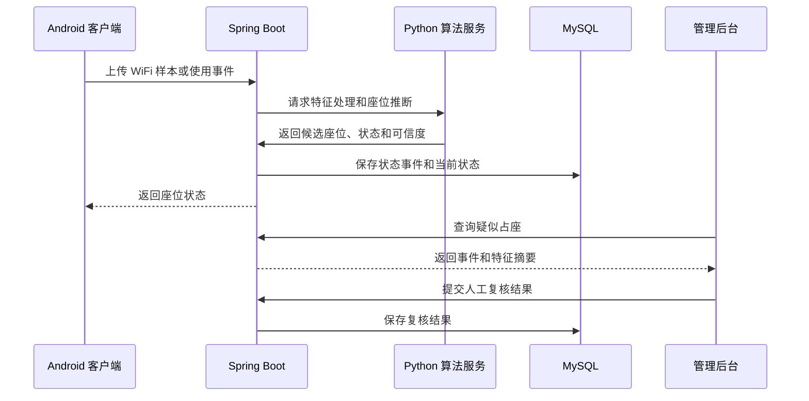

## 1. 文档说明
  

本文档用于指导“基于 WiFi 指纹的社区自习室无感座位引导与占座检测系统”的产品设计、软件开发、算法实验、现场部署和结题验收。
  

本文档基于项目原方案整理，并对原方案中“Android 或微信小程序均可作为前端”的表述进行了工程化修正。原方案要求完成 WiFi 指纹采集、座位级定位、占用识别、占座检测、座位引导、管理统计和现场评估；本文档进一步明确模块边界、技术选型、接口、数据结构、开发顺序和验收标准。


本文档的核心决策如下：
  
- 用户端采用 Android 原生应用，使用 Kotlin 开发。
- Android 端同时承担普通用户功能和 WiFi 指纹采集功能。
- 管理员端采用 Web 管理后台，避免把复杂管理功能塞进移动端。
- 后端采用 Spring Boot，数据库采用 MySQL。
- 算法训练和在线推理由 Python 完成，初期通过独立算法服务提供接口。
- 第一版只支持一个自习室，先完成完整闭环，再扩展多房间和小程序入口。
- 座位状态采用“算法判断 + 可信度 + 管理员复核”机制，不把设备信号直接等同于人员在座。

## 2. 平台选择结论

### 2.1 为什么不把微信小程序作为主要客户端

项目的核心能力是 WiFi 指纹采集和基于 RSSI 的座位级判断。微信小程序虽然适合展示座位图和提供轻量服务，但存在以下限制：

- WiFi 扫描接口受手机系统、微信版本和用户授权影响。
- iOS 和 Android 的行为不一致。
- 小程序不能保证后台持续采样。
- 小程序生命周期较短，无法稳定执行长时间采样任务。
- 小程序不能可靠地读取路由器连接日志。
- 座位级指纹识别需要连续、重复、可控的采样，不能依赖偶发的一次扫描。

因此，微信小程序可以作为后期的查询入口，但不适合承担本项目的核心感知链路。

### 2.2 为什么选择 Android 原生应用

Android 原生应用更适合本项目的原因如下：

- 团队已有 Android Studio 和 Java/移动应用开发基础。
- Android 可以在用户授权后获取 WiFi 扫描结果。
- 可以使用前台服务执行受控的周期性采样。
- 可以直接提供采集模式、座位标注和上传功能。
- 便于进行设备型号、权限和采样频率管理。
- 适合在实验室和目标自习室中快速进行可重复实验。

Android 也不能绕过系统限制。正式实现必须让用户明确授权定位、附近设备和 WiFi 权限，并在需要持续采样时使用前台服务。系统应提供手动刷新和采样失败提示，不能假设所有设备都能无限制后台扫描。

### 2.3 最终产品形态


Android 用户端和 Android 采集端可以先做成同一个 APK，通过登录角色和工作模式区分：

- 普通用户模式：查看座位、开始使用、离开、反馈异常。
- 采集模式：选择座位、连续采样、添加备注、上传数据。
- 管理员模式：查看状态和处理异常，也可以通过 Web 后台完成。

## 3. 项目范围

### 3.1 第一版目标

第一版应在一个真实或高度还原的自习室内完成以下闭环：

1. 建立座位地图和统一座位编号。
2. 采集多时段、多设备的 WiFi 指纹。
3. 建立座位级指纹库。
4. 根据 WiFi 特征识别用户所在座位或候选座位。
5. 显示空闲、使用中、疑似占座和维护中状态。
6. 提供空闲座位推荐。
7. 记录用户使用、离开和异常事件。
8. 为管理员提供人工复核和手动修正功能。
9. 输出准确率、召回率、F1、座位周转率和占座事件等评估指标。

### 3.2 第一版不做

- 多社区租户管理。
- 在线支付和会员体系。
- 人脸识别或摄像头识别。
- 需要额外铺设的压力传感器、RFID 或红外设备。
- 复杂的预约收费规则。
- 全自动处理所有“人不在但设备在”的情况。
- 依赖微信小程序后台持续扫描 WiFi。
- 跨城市部署和商业化运营能力。

### 3.3 后续扩展

- 微信小程序只读查询和推荐入口。
- 多房间、多楼层和多社区。
- 管理员 Web 大屏。
- 用户偏好学习和个性化推荐。
- AP 网关日志接入。
- 模型自动重训和漂移检测。
- 预约、签到、信用和违规处理。

## 4. 用户角色和权限

| 角色    | 权限                                  |
| ----- | ----------------------------------- |
| 普通用户  | 查看自习室和座位、查看推荐、开始使用、释放座位、查看个人记录、提交反馈 |
| 采集人员  | 进入采集模式、选择座位、采集 RSSI、上传指纹、查看采样状态     |
| 管理员   | 查看所有座位、人工复核、释放座位、锁定座位、修改配置、查看报表     |
| 项目管理员 | 管理用户角色、管理房间和座位、管理 AP、管理模型版本、导出数据    |

所有管理操作都必须写入操作日志，普通用户不能访问原始指纹样本、原始设备标识和算法调试数据。

## 5. 核心业务定义

### 5.1 座位状态

系统使用以下状态：

| 状态                  | 含义               |
| ------------------- | ---------------- |
| `AVAILABLE`         | 当前可使用            |
| `CANDIDATE`         | 检测到疑似使用，但证据不足    |
| `OCCUPIED`          | 已确认使用中           |
| `AWAY_CANDIDATE`    | 使用中的设备或信号暂时消失    |
| `SUSPECTED_HOLDING` | 疑似占座，需要继续观察或人工复核 |
| `MAINTENANCE`       | 管理员设置为维护中        |
| `UNKNOWN`           | 数据过期、采集异常或系统无法判断 |


前端显示名称可以简化，但后端必须保留完整状态。

### 5.2 占座定义

第一版将“占座”定义为：

> 座位在较长时间内被判定为存在设备或持续占用证据，但缺乏正常使用行为，且超过配置的离开或占用阈值。

系统输出的是“疑似占座”，不是法律意义上的确定违规。最终结果由管理员确认，管理员确认结果可用于后续模型评估和训练。

### 5.3 无感使用定义

本项目中的“无感”是指：

- 用户不需要每次都扫码签到；
- 用户不需要佩戴专用设备；
- 系统尽量根据 WiFi 和时间行为自动更新状态；
- 对无法可靠判断的情况提供一次点击确认或管理员复核。

不将“完全不需要用户授权、不需要任何确认”作为目标，因为这会造成误判和隐私风险。

## 6. 功能需求

### 6.1 Android 用户端

#### 登录与权限

- 手机号或项目内部账号登录。
- 申请 WiFi、定位、附近设备和通知权限。
- 清楚说明权限用途。
- 拒绝权限时仍可查看静态座位图，但不能使用需要采样的功能。
- 支持退出登录和清除本地缓存。

#### 自习室和座位

- 查看自习室列表。
- 查看开放时间、座位总数和空闲数量。
- 查看座位平面图。
- 按区域、靠窗、安静区等标签筛选。
- 点击座位查看状态、更新时间和推荐原因。
- 查看当前使用中的个人座位。

#### 座位推荐

推荐过程：

1. 过滤维护中和确认占用的座位。
2. 过滤数据过期的座位。
3. 根据用户偏好和区域条件排序。
4. 结合定位候选结果和座位可信度排序。
5. 返回最多 3 个推荐结果。

推荐结果必须说明原因，例如“空闲时间较长”“位于安静区”“距离入口较近”，不能只给出一个不可解释的分数。

#### 使用和释放

- 点击“开始使用”后建立使用会话。
- 系统继续根据采样结果更新状态。
- 用户可以主动暂时离开。
- 用户可以主动释放座位。
- 应用异常退出后，后台根据超时机制处理会话。

#### 反馈

- 座位状态错误。
- 座位已被占用但系统显示空闲。
- 系统显示占用但实际无人使用。
- WiFi 采样失败。
- 地图和实际布局不一致。

### 6.2 Android 采集模式

- 选择自习室、楼层和座位。
- 显示当前采集设备信息。
- 连续采集指定次数。
- 每次采集记录时间和环境备注。
- 显示已采样 AP 数量和有效 RSSI 数量。
- 支持暂停、重采和删除异常样本。
- 上传前显示数据摘要。
- 上传后生成批次编号。
  
建议每个座位每个时段至少采集 5 至 10 次，早、中、晚各采集一轮，并至少使用 2 至 3 种 Android 设备进行交叉验证。

### 6.3 Web 管理后台

#### 首页看板

- 房间总数。
- 座位总数。
- 空闲数量。
- 使用中数量。
- 疑似占座数量。
- 数据异常数量。
- 今日使用次数。
- 今日平均使用时长。

#### 座位管理

- 创建和编辑房间。
- 设置座位编号。
- 配置座位坐标。
- 设置座位标签。
- 设置维护状态。
- 导入和导出座位布局。

#### 实时状态

- 查看完整座位地图。
- 查看状态更新时间。
- 查看可信度。
- 查看对应设备会话的匿名编号。
- 手动修改状态。
- 查看状态变化历史。

#### 占座处理

- 查看疑似占座列表。
- 查看触发原因。
- 查看信号和时间特征。
- 标记为确认占座、正常使用或无法判断。
- 添加人工备注。
- 释放座位。

#### 数据和模型

- 查看采样批次。
- 查看无效样本。
- 查看模型版本。
- 发布或回滚模型。
- 查看定位准确率。
- 查看混淆矩阵和错误样本。

#### 统计分析

- 分时段使用率。
- 座位周转率。
- 各区域热度。
- 平均使用时长。
- 疑似占座数量。
- 人工干预次数。
- 系统启用前后对比。

## 7. 系统架构

### 7.1 模块划分

```text

android-app

├── user mode

├── collector mode

├── local cache

├── wifi scanner

└── foreground sampling service

  

backend

├── auth module

├── room module

├── seat module

├── occupancy module

├── recommendation module

├── event module

├── admin module

└── audit module

  

algorithm-service

├── preprocessing

├── fingerprint matching

├── occupancy scoring

├── model evaluation

└── model version management

  

admin-web

├── dashboard

├── room and seat management

├── alert review

├── data analysis

└── system configuration

```

  
### 7.2 数据流

  



  
### 7.3 实时更新策略

  
第一版使用轮询：

  
- Android 客户端进入房间页面后每 15 至 30 秒请求一次状态。
- 后台状态事件产生后立即更新数据库。
- Redis 只缓存房间状态快照，不保存最终业务事实。
- 座位状态超过配置时间没有新数据时变为 `UNKNOWN`。

  
第二版再评估 WebSocket。只有在用户量和实时性需求确实增加后，才引入长连接。

## 8. Android 客户端设计

### 8.1 技术选型

- Kotlin。
- Android Jetpack。
- MVVM 或单向数据流架构。
- Retrofit + OkHttp 访问后端。
- Room 保存本地任务和离线数据。
- Kotlin Coroutines 处理异步任务。
- WorkManager 处理可延迟同步。
- 前台服务处理用户明确开启的连续采样。
- Canvas 或自定义 View 绘制座位地图。
  
### 8.2 页面结构

```text

启动页

├── 登录页

├── 权限说明页

├── 首页

│   ├── 自习室选择

│   ├── 座位地图

│   ├── 座位详情

│   └── 推荐结果

├── 使用记录

├── 我的

└── 采集模式

    ├── 批次选择

    ├── 座位采样

    ├── 样本检查

    └── 上传结果

```

### 8.3 座位地图

座位地图不应把所有状态写死在图片中。推荐使用 JSON 描述布局：

```json

{

  "roomId": 1,

  "width": 1200,

  "height": 800,

  "seats": [

    {

      "seatId": 101,

      "code": "A-01",

      "x": 120,

      "y": 180,

      "width": 60,

      "height": 60,

      "zone": "window",

      "tags": ["靠窗", "安静区"]

    }

  ]

}

```

  
这样可以在不重新发版的情况下更新座位位置、状态和标签。
  
### 8.4 Android 权限
  
需要根据目标 Android 版本申请并解释：
  
- WiFi 扫描相关权限。
- 位置权限。
- 附近设备权限。
- 通知权限。
- 前台服务权限。
- 网络访问权限。
  
权限被拒绝时必须有降级流程。不能在没有说明用途的情况下强制用户授权。
  
## 9. 后端设计
  
### 9.1 技术选型
  
- Java 17 或项目统一的 LTS Java 版本。
- Spring Boot 3.x。
- Spring Web。
- Spring Validation。
- Spring Security。
- MyBatis-Plus 或 Spring Data JPA，二选一并保持统一。
- MySQL 8.x。
- Redis 作为可选缓存。
- OpenAPI/Swagger 生成接口文档。
- Docker Compose 管理开发环境。
  
### 9.2 后端职责
  
后端负责：
  
- 用户登录和角色鉴权。
- 房间、楼层和座位管理。
- 样本接收和基础校验。
- 算法服务调用。
- 座位状态机。
- 使用会话管理。
- 占座事件管理。
- 推荐结果生成。
- 管理员复核。
- 统计查询。
- 审计日志。
  
算法服务只负责特征处理、指纹匹配、模型推理和评估，不直接修改业务状态。
  
## 10. 算法方案
  
### 10.1 指纹向量
  
单次采样可以表示为：
  
```text

F = {bssid_1: rssi_1, bssid_2: rssi_2, ..., bssid_n: rssi_n}

```
  
预处理步骤：
  
1. 删除无效和明显异常的 RSSI。
2. 对 AP 按 BSSID 对齐。
3. 缺失 AP 使用统一默认值，例如 -100。
4. 使用中位数、移动平均或指数平滑降低短时波动。
5. 对不同设备的 RSSI 偏差进行归一化。
6. 生成可用于距离计算的固定维度向量。
  
### 10.2 座位识别
  
第一版算法顺序：
  
1. 最近邻基线。
2. 加权 KNN。
3. 决策树或随机森林作为对照。
4. 规则与算法融合。
  
推荐使用加权 KNN 作为第一版在线模型，因为它容易解释、训练成本低、适合样本量较小的项目。
  
输出内容：
  
- Top-1 座位。
- Top-3 候选座位。
- 距离分数。
- 可信度。
- 模型版本。
- 是否需要人工确认。
  
### 10.3 占用识别
  
特征包括：
  
- 设备信号是否持续出现。
- RSSI 的平均值和波动。
- 单次连续在线时长。
- 累计使用时长。
- 设备是否频繁切换座位。
- 用户是否主动开始使用。
- 用户是否主动释放。
- 座位状态是否长期没有人工确认。
- 同一匿名会话是否在多个座位间快速跳转。
  
规则示例：
  
```text

连续两次检测到同一座位候选结果，并且可信度达到阈值 -> CANDIDATE

CANDIDATE 持续稳定超过确认时间 -> OCCUPIED

OCCUPIED 状态下信号短暂消失 -> AWAY_CANDIDATE

AWAY_CANDIDATE 在离开阈值内恢复 -> OCCUPIED

AWAY_CANDIDATE 超过离开阈值 -> AVAILABLE

设备持续存在但用户行为异常且超过占座阈值 -> SUSPECTED_HOLDING

```
  
所有阈值都必须放入数据库配置，不能写死在客户端。
  
### 10.4 模型评估
  
数据划分应按日期、设备或采集批次划分，不能简单随机打散同一批采样数据。
  
需要输出：
  
- Top-1 准确率。
- Top-3 准确率。
- Precision。
- Recall。
- F1。
- 混淆矩阵。
- 不同时间段的准确率。
- 不同设备的准确率。
- 相邻座位之间的混淆情况。
- 环境变化前后的准确率。
  
## 11. 数据库设计
  
### 11.1 用户表 `user`
  
| 字段              | 类型           | 说明       |
| --------------- | ------------ | -------- |
| `id`            | bigint       | 主键       |
| `username`      | varchar(64)  | 用户名或内部账号 |
| `password_hash` | varchar(255) | 密码哈希，可选  |
| `role`          | varchar(32)  | 用户角色     |
| `status`        | tinyint      | 启用状态     |
| `created_at`    | datetime     | 创建时间     |
| `updated_at`    | datetime     | 更新时间     |

### 11.2 房间表 `room`
  
| 字段               | 类型           | 说明   |
| ---------------- | ------------ | ---- |
| `id`             | bigint       | 主键   |
| `name`           | varchar(128) | 房间名称 |
| `floor`          | varchar(32)  | 楼层   |
| `layout_version` | varchar(32)  | 布局版本 |
| `open_time`      | time         | 开放时间 |
| `close_time`     | time         | 关闭时间 |
| `status`         | varchar(32)  | 房间状态 |

### 11.3 座位表 `seat`
  

| 字段        | 类型          | 说明      |
| --------- | ----------- | ------- |
| `id`      | bigint      | 主键      |
| `room_id` | bigint      | 房间 ID   |
| `code`    | varchar(32) | 座位编号    |
| `x`       | decimal     | 地图 X 坐标 |
| `y`       | decimal     | 地图 Y 坐标 |
| `width`   | decimal     | 显示宽度    |
| `height`  | decimal     | 显示高度    |
| `zone`    | varchar(64) | 区域      |
| `tags`    | json        | 标签      |
| `status`  | varchar(32) | 座位维护状态  |

### 11.4 指纹样本表 `fingerprint_sample`

| 字段                 | 类型           | 说明           |
| ------------------ | ------------ | ------------ |
| `id`               | bigint       | 主键           |
| `batch_id`         | varchar(64)  | 采集批次         |
| `room_id`          | bigint       | 房间 ID        |
| `seat_id`          | bigint       | 座位 ID        |
| `collector_id`     | bigint       | 采集人员         |
| `device_code`      | varchar(64)  | 匿名采集设备编号     |
| `sample_time`      | datetime     | 采样时间         |
| `rssi_data`        | json         | AP 与 RSSI 数据 |
| `environment_note` | varchar(512) | 环境备注         |
| `quality_score`    | decimal      | 样本质量         |
| `status`           | varchar(32)  | 有效或无效        |

### 11.5 座位状态事件表 `seat_state_event`

| 字段                  | 类型           | 说明        |
| ------------------- | ------------ | --------- |
| `id`                | bigint       | 主键        |
| `seat_id`           | bigint       | 座位 ID     |
| `previous_state`    | varchar(32)  | 原状态       |
| `current_state`     | varchar(32)  | 新状态       |
| `source`            | varchar(32)  | 算法、用户或管理员 |
| `confidence`        | decimal      | 可信度       |
| `anonymous_session` | varchar(128) | 匿名会话标识    |
| `reason`            | varchar(512) | 状态原因      |
| `created_at`        | datetime     | 创建时间      |

### 11.6 占座事件表 `occupancy_alert`

| 字段                  | 类型           | 说明          |
| ------------------- | ------------ | ----------- |
| `id`                | bigint       | 主键          |
| `seat_id`           | bigint       | 座位 ID       |
| `level`             | varchar(32)  | 提示等级        |
| `trigger_reason`    | varchar(512) | 触发原因        |
| `first_detected_at` | datetime     | 首次发现        |
| `last_detected_at`  | datetime     | 最近发现        |
| `review_status`     | varchar(32)  | 待复核、正常、确认占座 |
| `reviewer_id`       | bigint       | 复核人         |
| `review_note`       | varchar(512) | 复核说明        |

## 12. API 设计

### 12.1 用户接口

```text

POST /api/v1/auth/login

POST /api/v1/auth/logout

GET  /api/v1/rooms

GET  /api/v1/rooms/{roomId}

GET  /api/v1/rooms/{roomId}/layout

GET  /api/v1/rooms/{roomId}/seat-states

GET  /api/v1/seats/{seatId}

GET  /api/v1/seats/recommendations

POST /api/v1/seats/{seatId}/sessions

POST /api/v1/sessions/{sessionId}/away

POST /api/v1/sessions/{sessionId}/release

GET  /api/v1/me/sessions

POST /api/v1/reports

```

### 12.2 采集接口

```text

POST /api/v1/collector/batches

POST /api/v1/collector/samples

POST /api/v1/collector/batches/{batchId}/complete

GET  /api/v1/collector/batches/{batchId}

```

### 12.3 管理接口

```text

GET  /api/v1/admin/dashboard

GET  /api/v1/admin/alerts

POST /api/v1/admin/alerts/{alertId}/review

POST /api/v1/admin/seats/{seatId}/force-state

POST /api/v1/admin/seats/{seatId}/maintenance

GET  /api/v1/admin/events

GET  /api/v1/admin/statistics

POST /api/v1/admin/models/{modelId}/publish

POST /api/v1/admin/config

```

### 12.4 算法接口

```text

POST /internal/algorithm/fingerprint/match

POST /internal/algorithm/occupancy/score

POST /internal/algorithm/evaluation/run

GET  /internal/algorithm/models/{modelId}

```

算法接口只允许内网或服务间身份访问，不对客户端开放。

## 13. 隐私和安全设计

### 13.1 数据最小化

- 不采集图像、人脸和生物特征。
- 不向普通用户展示其他用户身份。
- 不在客户端保存原始 MAC。
- 路由器日志中的 MAC 必须先进行加盐哈希。
- 匿名设备标识应定期轮换。
- 只保存完成定位和统计所需的数据。

### 13.2 数据保留

建议：

- 原始 WiFi 采样：保留至项目实验结束，或按批次脱敏后删除。
- 座位状态事件：保留 90 天。
- 统计数据：保留脱敏后的聚合结果。
- 管理操作日志：保留 180 天。
- 用户个人记录：支持用户申请删除。

### 13.3 访问控制

- 普通用户只能访问自己的使用记录。
- 采集人员只能上传和查看自己负责的采样批次。
- 管理员可以查看座位状态和处理事件。
- 项目管理员可以管理模型和系统配置。
- 管理接口必须使用服务端鉴权，不能仅依赖前端隐藏按钮。

## 14. 部署方案

### 14.1 开发环境

- Windows 或 Linux 开发机。
- Android Studio。
- JDK 17。
- MySQL 8。
- Python 3.11。
- Node.js 仅用于管理后台构建。
- Docker Desktop 或 Docker Engine。

### 14.2 测试环境

```text

Nginx

├── /api -> Spring Boot

└── /admin -> Web 管理后台

  

Spring Boot -> MySQL

Spring Boot -> Redis

Spring Boot -> Python Algorithm Service

```

### 14.3 生产或现场环境

最低配置可以使用一台云服务器：

- 2 核 CPU。
- 4 GB 内存。
- 50 GB SSD。
- HTTPS 域名。
- MySQL 定期备份。
- 防火墙只开放 80、443 和必要的 SSH 端口。

如果只是实验室内网试运行，可以先使用局域网服务器，但 Android 设备必须能访问服务端，且应配置固定地址或局域网域名。

## 15. 开发阶段和交付物

### 阶段一：需求和场地建模

工作内容：

- 确定场地。
- 记录座位数量和布局。
- 记录 AP 数量和位置。
- 统一座位编号。
- 完成用户和管理员访谈。
- 确定第一版指标。

交付物：

- 需求规格说明书。
- 座位地图。
- AP 分布图。
- 数据采集规范。
- 隐私说明初稿。

### 阶段二：数据采集和指纹建库

工作内容：

- 开发采集模式。
- 多时段采样。
- 清洗异常样本。
- 分析相邻座位可区分性。
- 建立第一版指纹库。

交付物：

- Android 采集功能。
- 指纹数据集。
- 数据清洗脚本。
- 指纹分布分析报告。

### 阶段三：算法和状态机

工作内容：

- 实现最近邻和 KNN。
- 建立行为标签。
- 实现状态机。
- 设计占座判定规则。
- 完成离线评估。

交付物：

- 模型文件。
- 算法服务。
- 评估脚本。
- 混淆矩阵和指标报告。

### 阶段四：业务系统开发

  

工作内容：

  

- 完成数据库。

- 完成用户端页面。

- 完成管理员后台。

- 完成状态接口。

- 完成推荐接口。

- 完成日志和权限。

  

交付物：

  

- Android APK。

- Web 管理后台。

- Spring Boot 服务。

- API 文档。

- 数据库脚本。

  

### 阶段五：联调和试运行

  

工作内容：

  

- 实际场地部署。

- 连续运行多个自然周。

- 记录误判和漏判。

- 统计管理员干预。

- 收集用户反馈。

- 调整模型和阈值。

  

交付物：

  

- 试运行日志。

- 问题清单。

- 修复版本。

- 用户反馈报告。

  

### 阶段六：结题和推广

  

交付物：

  

- 总结报告。

- 技术文档。

- 部署手册。

- 用户手册。

- 演示视频。

- 软件著作权或论文材料。

- 可复现实验数据和代码说明。

  

## 16. 测试计划

  

### 16.1 Android 测试

  

- Android 版本兼容。

- 不同手机型号。

- WiFi 权限拒绝。

- 定位权限关闭。

- WiFi 开关关闭。

- 网络断开后恢复。

- 应用切后台。

- 前台服务被系统停止。

- 电量不足。

- 采样上传失败重试。

  

### 16.2 后端测试

  

- 登录鉴权。

- 角色越权。

- 座位状态转换。

- 重复事件处理。

- 数据过期处理。

- 并发更新同一座位。

- 管理员强制释放。

- 数据库事务。

- 接口参数校验。

  

### 16.3 算法测试

  

- 不同时间段。

- 不同采集设备。

- 人数变化。

- AP 信号波动。

- AP 暂时不可用。

- 相邻座位混淆。

- 设备信号短暂丢失。

- 设备持续存在但人员离开。

  

### 16.4 用户体验测试

  

- 用户能否快速找到空闲座位。

- 推荐结果是否容易理解。

- 状态更新时间是否清楚。

- 权限说明是否明确。

- 误判时能否快速反馈。

- 管理员能否快速处理异常。

  

## 17. 验收标准

  

### 17.1 功能验收

  

- 能创建一个自习室和完整座位地图。

- 能完成指纹采集、上传和查询。

- 能查看座位实时状态。

- 能进行座位推荐。

- 能开始和结束使用会话。

- 能产生状态变化事件。

- 能生成疑似占座事件。

- 管理员能完成人工复核。

- 能查询基本统计数据。

  

### 17.2 性能验收

  

- 核心接口 p95 响应时间不超过 1 秒。

- 座位地图加载时间不超过 3 秒。

- 状态刷新延迟目标为 30 至 60 秒。

- 单房间 100 个座位时页面不卡顿。

- 连续运行 7 天不出现数据库明显异常。

  

### 17.3 算法验收

  

目标值建议如下，最终以实际实验结果为准：

  

- Top-1 座位识别准确率不低于 80%。

- Top-3 座位识别准确率不低于 90%。

- 占用识别 F1 不低于 0.80。

- 每个误判样本可以追溯到原始事件、特征和模型版本。

- 能够区分正常离开和超过阈值的疑似占座。

  

### 17.4 安全验收

  

- 普通用户不能访问管理接口。

- 普通用户不能查看原始指纹数据。

- 原始设备标识不直接展示。

- 管理操作有审计记录。

- 传输过程使用 HTTPS 或受控内网。

- 用户隐私说明可在客户端查看。

  

## 18. 主要风险和处理原则

  

### WiFi 信号不稳定

  

使用多次采样、时间段建模、滤波和模型版本管理。不能只采集一次就宣称座位识别可靠。

  

### 设备和系统差异

  

采集阶段必须使用多个 Android 设备。算法评估必须按设备分别统计，不能只报告总体平均值。

  

### 设备不等于人员

  

将结果定义为疑似状态，结合用户操作、时间行为和管理员复核，不把 WiFi 设备存在作为唯一证据。

  

### AP 位置或配置变化

  

维护 AP 登记表，每次调整 AP 后建立新的模型版本，并重新采集受影响区域。

  

### 项目范围过大

  

先完成单房间闭环。多房间、微信小程序、预约和复杂推荐全部放入后续版本。

  

### 隐私和用户接受度

  

所有采集都要有明确用途和授权说明，尽可能使用匿名标识，并允许用户查看和删除个人记录。

  

## 19. 推荐的代码仓库结构

  

```text

wifi-seat-system/

├── android-app/

│   ├── app/

│   ├── collector/

│   └── README.md

├── backend/

│   ├── src/main/java/

│   ├── src/main/resources/

│   └── README.md

├── algorithm-service/

│   ├── app/

│   ├── scripts/

│   ├── models/

│   ├── data-sample/

│   └── README.md

├── admin-web/

│   ├── src/

│   └── README.md

├── database/

│   ├── schema.sql

│   └── seed.sql

├── deployment/

│   ├── docker-compose.yml

│   ├── nginx.conf

│   └── README.md

└── docs/

    ├── api.md

    ├── data-collection.md

    ├── algorithm-evaluation.md

    ├── privacy.md

    └── deployment.md

```

  

## 20. 开发顺序

  

建议严格按照以下顺序推进：

  

1. 先完成座位地图和座位编号。

2. 再完成 Android 采集功能。

3. 再完成离线数据清洗和 KNN 基线。

4. 再完成后端座位和事件接口。

5. 再完成 Android 用户端地图和推荐。

6. 再完成状态机和疑似占座规则。

7. 再完成管理员后台。

8. 再做真实场地联调。

9. 最后做模型优化、统计分析和展示包装。

  

不建议先做复杂界面，也不建议先做微信小程序。没有可靠的指纹数据和状态判定，前端界面只能展示静态假数据，无法证明项目核心价值。

  

## 21. 最终技术路线

  

本项目最终采用：

  

```text

Android 原生客户端

    ↓

WiFi 指纹采集与用户使用会话

    ↓

Spring Boot 业务后端

    ↓

MySQL 座位、事件和用户数据

    ↓

Python KNN/规则融合算法服务

    ↓

座位状态、推荐结果和疑似占座事件

    ↓

Android 用户端 + Web 管理后台

```

  

这条路线与原方案中的研究内容保持一致，同时解决了微信小程序无法稳定承担 WiFi 指纹采集的问题。第一阶段应以单房间、可重复采样、可解释算法和完整运行闭环为目标；只有在实验结果稳定后，才扩展到微信小程序、多房间和更复杂的运营功能。
